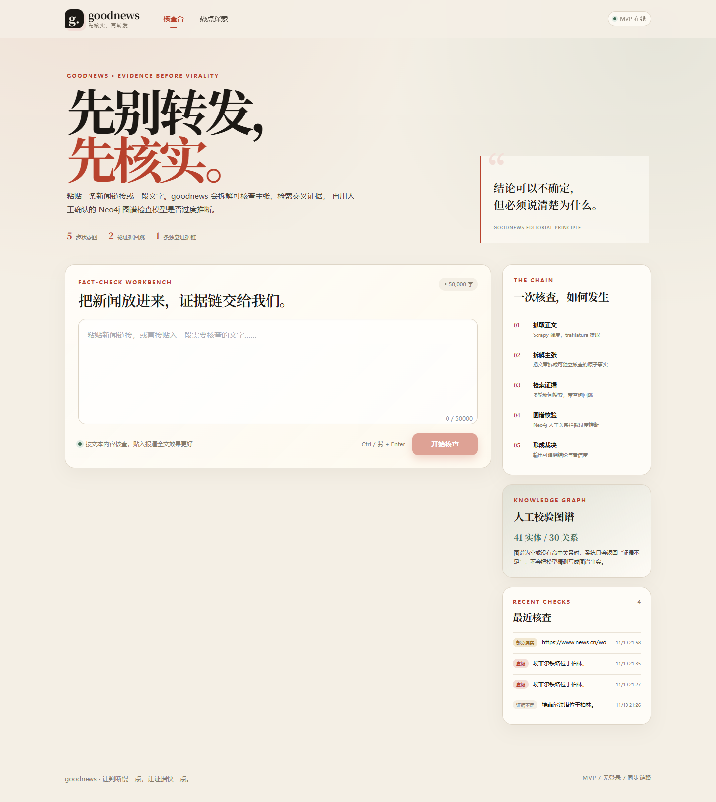
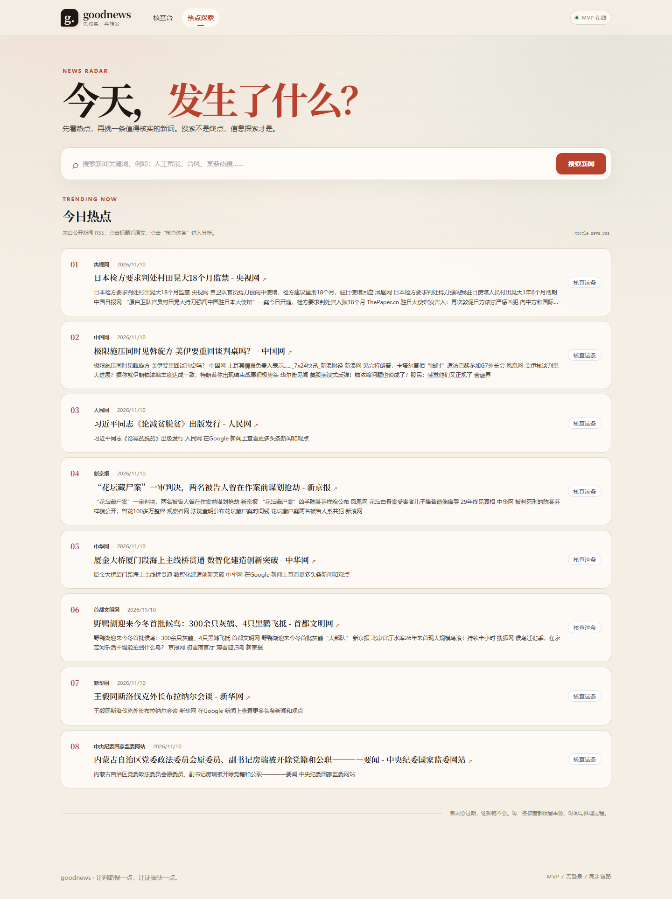
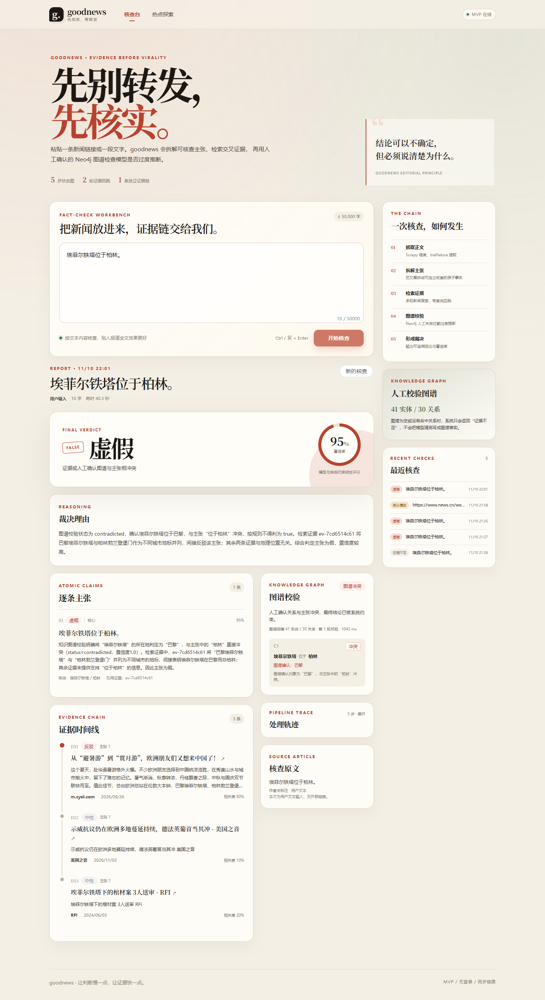

# goodnews

> 新闻热点搜索 + 信息探索 + 假新闻分析平台 MVP
>
> **先别转发，先核实。**

goodnews 接收一个新闻链接或一段文本，通过 LangGraph 编排
`fetch_article → extract_claims → retrieve_evidence → graph_verify → adjudicate`
五个节点，输出带证据、逐条主张、图谱校验和推理过程的结构化裁决。

## 界面预览





## 当前实现范围

- ✅ Vue 3 + TypeScript + Vite + Pinia + Vue Router + Element Plus
- ✅ Python **3.11.6** + FastAPI + Pydantic v2
- ✅ LangGraph 状态图，`graph_verify` 后按证据覆盖不足条件回跳，最多 N 轮
- ✅ 手搓 OpenAI SDK `llm_client`（默认 DeepSeek，JSON 模式 / 重试 / 流式能力）
- ✅ Neo4j 异步驱动 + Cypher 仓库 + 确定性图谱校验
- ✅ Scrapy + scrapy-playwright + trafilatura 正文提取
- ✅ PostgreSQL 持久化核查历史；pgvector 仅建占位表不使用
- ✅ Redis 仅作搜索缓存
- ❌ 无登录 / JWT、无 Celery、无多 Agent、无桌面端、无向量语义去重（按范围）

## 技术栈

| 层 | 技术 |
|----|------|
| 前端 | Vue 3 `<script setup>`、TypeScript、Vite、Pinia、Vue Router、Element Plus、Axios |
| 后端 | Python 3.11.6、FastAPI、Uvicorn、Pydantic v2 |
| 编排 | LangGraph（仅状态编排，节点内直接调用 `llm_client`） |
| LLM | OpenAI Python SDK，默认 `https://api.deepseek.com` / `deepseek-chat` |
| 数据 | PostgreSQL 16 + SQLAlchemy 2 async + asyncpg；pgvector 占位 |
| 图谱 | Neo4j 5.26 Community，官方 `neo4j` async driver |
| 采集 | Scrapy、scrapy-playwright、trafilatura、Google News URL 解析 |
| 缓存 | Redis（仅搜索缓存，可关闭） |

## 目录结构

```text
D:\goodnews
├─ backend/
│  ├─ app/
│  │  ├─ api/v1/                 # health / factcheck / search / graph 路由
│  │  ├─ core/                   # pydantic-settings + URL 安全校验
│  │  ├─ db/                     # async engine、表、历史仓库
│  │  ├─ llm/                    # 唯一 OpenAI SDK 网关
│  │  ├─ models/                 # API / LLM / 状态 Pydantic 模型
│  │  ├─ graph/                  # state、prompts、nodes、builder、guardrails
│  │  ├─ knowledge_graph/        # Neo4j repository、verifier、seed data
│  │  ├─ crawler/                # Scrapy spider、runner、trafilatura
│  │  ├─ services/               # 业务编排、搜索、证据、缓存
│  │  └─ main.py
│  ├─ scripts/                   # seed_graph.py、check_llm.py
│  ├─ tests/                     # 10 个后端测试
│  ├─ pyproject.toml
│  └─ README.md
├─ frontend/
│  ├─ src/api/                   # 统一 axios 实例 + factcheck/search/health
│  ├─ src/types/                 # 与 Pydantic 模型一一对应
│  ├─ src/stores/                # Pinia
│  ├─ src/composables/           # 页面业务逻辑
│  ├─ src/views/                 # 只做布局与组合
│  ├─ src/components/            # 裁决卡、主张、证据、图谱、轨迹等
│  └─ package.json
├─ scripts/                       # Windows .bat 启动/停止/种子脚本（ASCII）
├─ docs/architecture.md           # 架构图、分层、约束
├─ docker-compose.yml             # 只新增 Neo4j；复用现有 PostgreSQL/Redis
├─ .env / .env.example            # 真实密钥只在 .env，且被 .gitignore 忽略
└─ README.md
```

## 快速启动

### 前置条件

1. Windows + Python **3.11.6**（本项目固定使用；本机为 `D:\Python3.11\python.exe`）
2. Node.js 22+ / npm 10+
3. Docker Desktop
4. 已运行的 **pgsql** 容器（PostgreSQL 16）与 **redis-stack** 容器
5. 本仓库自带 `docker-compose.yml`，只负责启动 Neo4j

### 1. 环境变量

```bat
copy .env.example .env
```

编辑根目录 `.env`，至少填写：

- `DEEPSEEK_API_KEY` — DeepSeek API Key
- `POSTGRES_*` — 现有 PostgreSQL 连接信息（默认库名 `goodnews`）
- `NEO4J_PASSWORD` — 与 `docker-compose.yml` 使用的 Neo4j 密码一致
- `REDIS_URL` — 默认 `redis://localhost:6379/0`

`.env` 已经被 `.gitignore` 忽略；不要把它改成明文提交。前端不保存任何密钥。

### 2. 后端

```bat
cd /d D:\goodnews\backend
D:\Python3.11\python.exe -m venv .venv
.venv\Scripts\python.exe -m pip install -e ".[dev]"
..\scripts\start-neo4j.bat
.venv\Scripts\python.exe -m scripts.seed_graph
.venv\Scripts\uvicorn.exe app.main:app --reload --host 127.0.0.1 --port 8000
```

API 文档：<http://127.0.0.1:8000/docs>

### 3. 前端

```bat
cd /d D:\goodnews\frontend
npm install
npm run dev
```

打开 <http://127.0.0.1:5173>。Vite 已把 `/api` 代理到 `127.0.0.1:8000`。

### 一键启动

双击 `scripts\start-all.bat`：启动 Neo4j、后端、前端，并打开浏览器。
单独脚本：`start-backend.bat`、`start-frontend.bat`、`start-neo4j.bat`、`seed-graph.bat`。

## 环境变量清单

完整模板见 [.env.example](.env.example)。变量名与含义：

| 分组 | 变量 |
|------|------|
| 应用 | `APP_NAME` `APP_ENV` `DEBUG` `API_PREFIX` `CORS_ORIGINS` |
| PostgreSQL | `POSTGRES_HOST` `POSTGRES_PORT` `POSTGRES_DB` `POSTGRES_USER` `POSTGRES_PASSWORD` `DATABASE_ENABLED` `DATABASE_ECHO` `DATABASE_URL`（可选覆盖） |
| Redis | `REDIS_URL` `REDIS_ENABLED` `CACHE_TTL_SECONDS` |
| Neo4j | `NEO4J_URI` `NEO4J_USER` `NEO4J_PASSWORD` `NEO4J_DATABASE` `NEO4J_ENABLED` |
| LLM | `DEEPSEEK_API_KEY` `LLM_BASE_URL` `LLM_MODEL` `LLM_TIMEOUT_SECONDS` `LLM_MAX_RETRIES` `LLM_TEMPERATURE` `LLM_MAX_TOKENS` `LLM_JSON_REPAIR_ATTEMPTS` |
| 核查 | `FACTCHECK_MAX_EVIDENCE_ROUNDS` `MAX_CLAIMS` `MAX_ARTICLE_CHARS` `MAX_FACTCHECK_INPUT_CHARS` `EVIDENCE_FETCH_TOP_N` |
| 搜索 | `SEARCH_PROVIDER`（`google_news_rss` / `bing_rss`）`SEARCH_RESULT_LIMIT` `SEARCH_TIMEOUT_SECONDS` |
| 爬虫 | `CRAWLER_TIMEOUT_SECONDS` `CRAWLER_PLAYWRIGHT_ENABLED` `PLAYWRIGHT_TIMEOUT_MS` `PLAYWRIGHT_BROWSER_CHANNEL` `ALLOW_PRIVATE_URLS` |
| 本机推送凭据 | `GITHUB_TOKEN` `GITEE_TOKEN`（仅本地 `.env`，应用不读取） |

## API

| 方法 | 路径 | 说明 |
|------|------|------|
| GET | `/api/v1/health` | 依赖健康、LLM 配置、图谱规模 |
| POST | `/api/v1/factcheck` | 同步跑完整五节点链路 |
| GET | `/api/v1/factcheck/history` | 最近核查记录 |
| GET | `/api/v1/factcheck/{id}` | 单次核查完整结果 |
| POST | `/api/v1/search` | 关键词新闻搜索 |
| GET | `/api/v1/search/hot` | 热点新闻 |
| GET | `/api/v1/graph/stats` | Neo4j 实体/关系规模 |

### 核查示例

```bat
curl.exe -X POST http://127.0.0.1:8000/api/v1/factcheck ^
  -H "Content-Type: application/json" ^
  -d "{\"input_type\":\"text\",\"content\":\"埃菲尔铁塔位于柏林。\",\"max_evidence_rounds\":0}"
```

### 搜索示例

```bat
curl.exe -X POST http://127.0.0.1:8000/api/v1/search ^
  -H "Content-Type: application/json" ^
  -d "{\"query\":\"人工智能\",\"limit\":5}"
```

## 各模块验证方式

| 模块 | 验证命令 / 方式 |
|------|----------------|
| LLM 客户端 | `cd backend && .venv\Scripts\python.exe -m scripts.check_llm` |
| LangGraph 全链路 | 上面的 `POST /api/v1/factcheck`，观察 `trace` 与 `graph_verification` |
| 图谱种子 | `.venv\Scripts\python.exe -m scripts.seed_graph`，应输出 `entities=41, relations=30` |
| 图谱确定性校验 | 提交 `埃菲尔铁塔位于柏林。`，应返回 `verdict=false` 且 `graph.status=contradicted` |
| 搜索 | `GET /api/v1/search/hot?limit=3` 或 `POST /api/v1/search` |
| 爬虫 | `.venv\Scripts\python.exe -m app.crawler.runner --url <公开文章URL> --output crawler-output.json` |
| 数据库历史 | `GET /api/v1/factcheck/history` |
| 后端测试 | `.venv\Scripts\python.exe -m pytest -q` → **10 passed** |
| 后端静态检查 | `.venv\Scripts\ruff.exe check app scripts tests` → all checks passed |
| 前端类型检查 | `cd frontend && npm run typecheck` |
| 前端生产构建 | `npm run build` |
| 浏览器 UI 冒烟 | 后端和前端均在运行时：`scripts\ui-smoke.bat`（截图输出到 `docs/screenshots/`） |

## 关键设计约束

1. **LLM 唯一出口**：业务代码只依赖 `app/llm/client.py`。没有 LangChain `ChatOpenAI`、Chain 或 AgentExecutor。
2. **图谱不脑补**：LLM 只负责把主张映射成候选三元组；`supported` / `contradicted` 必须来自 Neo4j 中人工确认的精确关系。空图或无法映射 → `insufficient`。
3. **代码级裁决护栏**：图谱冲突拦截 `true`；无证据 + 图谱不足 → `insufficient_evidence`；未覆盖主张不允许整体 `true`；缺图谱时置信度封顶。
4. **页面不再长业务逻辑**：API → store/composable → view，组件 props/emits 明确。
5. **SSRF 基础防护**：用户 URL 先校验 scheme、解析 DNS 并阻断内网/回环/保留地址。
6. **密钥隔离**：真实 token/API key 只存在根 `.env`，由 `.gitignore` 排除；Git remote、提交信息、`.git/config` 均不含 token。

## 已知限制与后期重构点

- 当前 `POST /factcheck` 是同步请求，20–60 秒可能等待；后期改 Celery/队列 + SSE 流式进度。
- Scrapy 每个 URL 通过子进程运行以规避 Twisted reactor 重启限制；后期独立爬虫服务或 worker pool。
- 搜索使用公开 RSS，稳定性受源站影响；后期增加商业搜索 API provider。
- 图谱只有 41 个手工实体、30 条关系，仅用于验证“拦截过度推断”；后期人工审核后台 + 导入流程。
- `factcheck_records.result` 以 JSONB 保存完整快照；后期拆分 claims/evidence 关系表做统计。
- `article_embeddings` 与 pgvector 只建表不查询；后期才做语义去重。
- 按要求不含登录/JWT；公开部署前必须补认证、限流、审计与 URL 重定向深度防护。
- 前端未做 SSR/PWA/桌面端，符合本期范围。

## 设计与验证记录

- 架构图与分层：[docs/architecture.md](docs/architecture.md)
- 后端模块说明：[backend/README.md](backend/README.md)
- 前端模块说明：[frontend/README.md](frontend/README.md)
