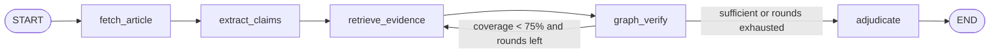

# goodnews MVP architecture

## Fact-check flow



## Layer boundaries

```text
Vue view / components
  -> composable / Pinia
  -> src/api (single axios client)
  -> FastAPI route (no LLM / no Cypher)
  -> service (business orchestration)
  -> LangGraph node
     -> llm_client (only OpenAI SDK gateway)
     -> search / crawler
     -> graph verifier -> Neo4j repository (only Cypher)
  -> PostgreSQL history snapshot
```

## Guardrails

1. Graph verification is deterministic after candidate mapping: only exact,
   manually seeded Neo4j relations can produce `supported` / `contradicted`.
2. Empty or unmapped graph -> `insufficient`; prompts are explicitly told not
   to claim graph support.
3. Code-level guardrails (not only prompts):
   - graph contradiction cannot produce overall `true`;
   - no evidence + insufficient graph -> `insufficient_evidence`;
   - unresolved claims cannot produce overall `true`;
   - confidence is capped when the graph has no usable relation.
4. Per-claim verdicts must exist; missing ones are filled as insufficient.

## Explicit MVP boundaries

- No login/JWT, no Celery, no multi-agent, no vector semantic dedupe.
- Redis is only a search cache.
- `article_embeddings` is created for the future but never queried.
- Search uses public RSS; a paid provider is a later adapter.
- Synchronous API; LLM streaming support exists in `llm_client` but no SSE
  endpoint yet.
